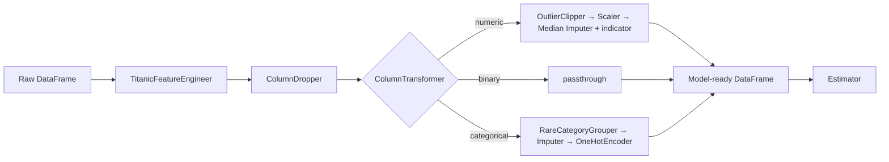
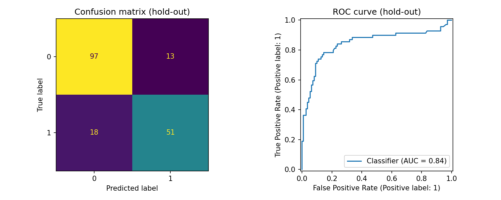

# 🛠️ Production-Grade ML Preprocessing Pipeline (Scikit-learn)

A reproducible, **leakage-proof** preprocessing pipeline built with scikit-learn's
`Pipeline` + `ColumnTransformer` and **custom pandas-aware transformers**.
Demonstrated on the Titanic dataset (891 rows, mixed numeric/categorical data, real missing values).

> **Why this matters:** in production, most ML bugs are data bugs. If imputation, scaling or
> encoding statistics are computed on data the model will later be tested on, your validation
> score is a lie. This project packages *every* preprocessing step and the model into **one
> object** that is fitted only on training data, cross-validated safely, saved once, and served on raw rows.

---

## ✨ Features

| Capability | Implementation |
|---|---|
| Missing values | `SimpleImputer` (median for numeric + missing-indicator flag, `"missing"` category for categorical) |
| Scaling | `StandardScaler` (swappable: `RobustScaler`, `MinMaxScaler`) |
| Encoding | `OneHotEncoder(handle_unknown="ignore")` — safe for unseen categories in production |
| Outliers | **Custom** `OutlierClipper` (IQR winsorising, bounds learned on train only) |
| Rare categories | **Custom** `RareCategoryGrouper` (rare + unseen → `"Other"`) |
| Feature engineering | **Custom** `TitanicFeatureEngineer` (FamilySize, IsAlone, Title, Deck, HasCabin) |
| Column handling | **Custom** `ColumnDropper` |
| Output | DataFrame with real column names (`set_output(transform="pandas")`) |
| Tuning | `GridSearchCV` over **preprocessing and model** hyper-parameters together |
| Persistence | Single `joblib` artefact (preprocessing + model) |
| Quality | 12 `pytest` unit tests, type hints, docstrings |

## 🏗️ Architecture



## 📁 Project structure

```
ml-preprocessing-pipeline/
├── data/titanic.csv
├── src/
│   ├── preprocessing/
│   │   ├── transformers.py     # custom transformer classes
│   │   └── pipeline.py         # Pipeline + ColumnTransformer factory
│   ├── train.py                # CV, GridSearch, evaluation, save model
│   └── leakage_demo.py         # leaky vs correct workflow
├── tests/test_transformers.py
├── reports/                    # metrics.json, evaluation.png
├── models/                     # trained pipeline (git-ignored)
├── requirements.txt
└── pytest.ini
```

## 🚀 Quick start

```bash
git clone https://github.com/MuhammadEbadullah/ml-preprocessing-pipeline.git
cd ml-preprocessing-pipeline
python -m venv .venv && source .venv/bin/activate   # Windows: .venv\Scripts\activate
pip install -r requirements.txt

python -m src.train          # train + tune + evaluate + save
python -m src.leakage_demo   # see why pipelines prevent leakage
python -m pytest             # run unit tests
```

### Use the pipeline

```python
import pandas as pd
from src.preprocessing import build_preprocessor

df = pd.read_csv("data/titanic.csv")
X = df.drop(columns="Survived")

pre = build_preprocessor()
X_clean = pre.fit_transform(X)      # DataFrame, 28 named columns, 0 NaNs
```

### Serve a saved model on raw data

```python
import joblib, pandas as pd
model = joblib.load("models/titanic_pipeline.joblib")
model.predict(pd.DataFrame([{...raw row...}]))   # no manual preprocessing needed
```

## 🧠 Design decisions (the "senior engineer" part)

1. **`fit` learns only from training data.** Custom transformers store learned state in `*_`
   attributes (`lower_bounds_`, `frequent_categories_`) following scikit-learn conventions.
2. **Transformers never mutate their input** (they work on copies).
3. **`get_feature_names_out` is implemented** so the whole pipeline returns a labelled DataFrame —
   crucial for debugging and feature importance.
4. **Scaling happens before imputation.** Scalers ignore NaN, so the 0/1 missing-indicator
   column is not accidentally scaled.
5. **`handle_unknown="ignore"` + `RareCategoryGrouper`** → unseen categories at inference time
   never crash the service.
6. **Preprocessing hyper-parameters are tunable** (e.g. IQR factor, rare-category threshold)
   via `GridSearchCV` parameter names like `preprocessor__column_transformer__num__clipper__factor`.
7. **Clear errors:** non-DataFrame input raises a `TypeError`; calling `transform` before `fit`
   raises `NotFittedError`.

## 📊 Results

Stratified 80/20 split, 5-fold stratified CV on the training portion only.

| Model | CV ROC-AUC |
|---|---|
| Logistic Regression | 0.8685 ± 0.0175 |
| Random Forest | 0.8679 ± 0.0135 |
| **Random Forest (tuned, incl. preprocessing params)** | **0.8792** |

**Hold-out test set (untouched until the end):** accuracy **0.827**, F1 **0.767**, ROC-AUC **0.845**.



### Data-leakage demo (`python -m src.leakage_demo`)

| Experiment | Leaky | Correct (Pipeline) |
|---|---|---|
| Titanic, preprocessing fit on all data vs per-fold (ROC-AUC) | 0.8703 | 0.8704 |
| Pure-noise data + feature selection (accuracy, true value = 0.50) | **0.838** | **0.521** |

On Titanic the leak from imputing/scaling is tiny (honest result — unsupervised statistics leak
little). But the noise experiment shows how a supervised step done outside the pipeline makes a
useless model look excellent. A `Pipeline` removes this entire class of bugs by construction.

## ⚠️ Limitations / next steps

- `TitanicFeatureEngineer` is dataset-specific; it is a template for domain feature engineering.
- Add `sklearn.set_config(transform_output="pandas")` globally if you prefer.
- Next: wrap with FastAPI for serving, add Great Expectations data validation, track runs with MLflow, add CI (GitHub Actions) to run tests.

## 📝 License

MIT
